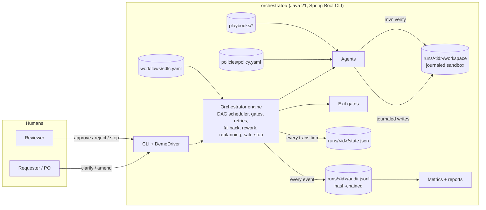
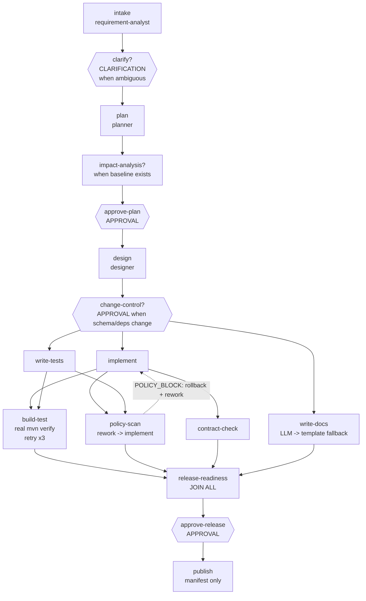
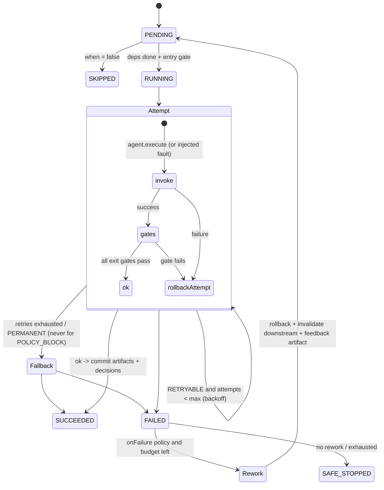

# Architecture overview

This repository holds three independent Maven projects:

| Project | Purpose | Touched by this assignment? |
|---|---|---|
| `/` (root `pom.xml`, `src/`) | Pre-existing Product API | **No.** Read-only, protected by policy |
| `url-shortener/` | The product: URL shortener with analytics and abuse controls | New |
| `orchestrator/` | The agentic SDLC engine that plans, builds, verifies and governs changes to the shortener | New |

The orchestrator is the main deliverable. The shortener is both a working service and the output that the orchestrator's three scenarios produce.

## 1. Components

| Component | Responsibility | Key classes |
|---|---|---|
| Workflow definition | Declarative DAG: stages, `dependsOn`, `reads`/`writes`, `when`, gates, retry, fallback, rework, timeouts, budget | `workflows/sdlc.yaml`, `WorkflowDefinition`, `WorkflowGraph` (validates cycles, unknown deps, rework targets) |
| Engine | Schedules ready stages in parallel, joins, applies gates and recovery, pauses at human checkpoints, persists, audits | `Orchestrator` |
| Shared state | Versioned artifacts with content hashes and `derivedFrom` lineage; decisions; approvals; clarifications | `RunState`, `ArtifactVersion`, `Decision`, `RunStore` |
| Sandbox | All file changes go through a per-stage journal, so a stage's changes can always be rolled back (including after a crash) | `Workspace` |
| Audit | Append-only JSONL, SHA-256 hash chain, file-locked for multiple writers | `AuditLog`, `EventType` |
| Agents | Units of work behind one interface; each declares its `ExecutionMode` (REAL / SCRIPTED / LLM) | `agents/*` |
| Policy | Policy-as-code guardrails over every changed file | `PolicyEngine`, `policy.yaml` |
| Metrics | Derived only from the audit log: success rate, retry/rollback frequency, MTTR, end-to-end latency | `MetricsCalculator`, `ReportWriter` |

## 2. Orchestration model: the dependency graph

| Mechanism | How it works |
|---|---|
| **Sequential and parallel paths** | A stage becomes ready when all of its `dependsOn` stages are `SUCCEEDED` or `SKIPPED`. Ready stages run concurrently on a bounded pool (4 threads). `implement`, `write-tests` and `write-docs` fan out together, as do `build-test`, `policy-scan` and `contract-check`. |
| **Synchronization** | Joins are implicit: `release-readiness` waits for build, policy, contract and docs. When stages fail, the engine first waits for in-flight work to finish, then handles the failures in topological order. |
| **Entry gates** | Before a stage starts: its `when` condition is checked (false means the stage is `SKIPPED`, which makes the path through the graph depend on the data), required `reads` must exist, and approvals must be granted. A missing required input safe-stops the run. |
| **Exit gates** | `outputs-present` always applies, plus named gates: `build-green`, `tests-not-decreased`, `release-ready`. A failed gate counts as a failed attempt. |
| **Cross-stage context** | Agents see only their declared `reads`, as a consistent snapshot taken when the stage starts. Outputs are buffered and committed only if the gates pass. |
| **Decision lineage** | Every artifact version records its producer and the exact input versions it was `derivedFrom`. Decisions record a summary, rationale, alternatives considered and inputs. `orch lineage <run> <artifact>` prints the tree. |
| **Non-linear execution** | Conditional stages, the policy-driven rework loop (`policy-scan` → `implement`), and replanning when an artifact is amended. |

## 3. Control flow of one agent stage

**Failure taxonomy.** `RETRYABLE` failures (I/O, Maven transport errors, injected transient faults) go to bounded retry. `PERMANENT` failures (compile or test failures, an unavailable model) skip retry and go to the fallback agent. `POLICY_BLOCK` is never retried or bypassed by fallback; it can only be resolved by declared rework or by a human.

## 4. Governance controls

| Control | Implementation | Evidence |
|---|---|---|
| Human approval checkpoints | `APPROVAL` stages: `approve-plan`, `change-control` (only when there are schema or dependency changes), `approve-release`. The run pauses (`WAITING_APPROVAL`) and is persisted. A person runs `orch approve`/`reject`. Approvals record the exact artifact versions they cover. | `APPROVAL_*` events; `OrchestratorTest.pausesForInteractiveApproval…` |
| Delegated approvals | `--auto-approve-as` or the demo driver. Always recorded as `delegated:<name>`, mode `DELEGATED`, never as a person. | `ScenarioFlowTest.ambiguous…` asserts this |
| Clarification checkpoint | `CLARIFICATION` stage when the analyst finds undefined terms. The run waits for answers and does not guess. A timeout safe-stops it. | ambiguous scenario |
| Bounded retries | Per-stage `retry` (max attempts, exponential backoff), plus a run-wide execution budget | greenfield `build-test` |
| Fallback | `fallbackAgent`, tried once after the primary agent fails terminally | `write-docs`: LLM → template |
| Rollback | Per-attempt and per-invalidation compensation via the workspace journal. Crash recovery rolls back stages that were `RUNNING` when the process died. | `ROLLBACK_COMPLETED`; `WorkspaceTest`, `recoversStageInterruptedByCrash` |
| Rework | `onFailure: {stage, maxReworks, feedbackArtifact}` | brownfield privacy block |
| Safe-stop | Triggers: kill switch (`orch stop`), budget, a stage failing terminally, rework exhausted, rejection, approval or clarification timeout, missing input, no progress. State is preserved and the run is resumable. | `SAFE_STOP` event; safe-stop demo |
| Dynamic replanning | `orch amend` commits a new version of an artifact. The engine invalidates every reader of it and everything downstream, rolls their files back, voids their approvals, and keeps unaffected work. | ambiguous scenario: intake and clarify preserved |
| Policy guardrails | `pii-raw-ip`, `secrets`, `protected-paths`, `migration-immutability`, `dependency-allowlist` (BLOCK); `change-size`, `tests-accompany-code` (WARN). Also enforced structurally: sandbox path escape and concurrent writes to the same file by two stages raise `POLICY_BLOCK`. | `PolicyEngineTest`, `WorkspaceTest` |
| Change control | Agents cannot push, merge or write outside the sandbox. `publish` only emits a manifest; promoting it into the repository is a human action. | `PublisherAgent` |
| Audit-grade traceability | Every transition is in a hash-chained log with actor, stage, attempt, inputs and outputs. `orch verify-audit` detects edits and deletions. | `AuditLogTest` |
| Reliability metrics | Success rate, first-attempt success, retry frequency, rollbacks per run, reworks, replans, safe-stops, MTTR (wall-clock and excluding human wait), end-to-end latency p50/p95 (total and active) | `report.md`, `metrics.json`, `orch metrics` |

## 5. Agents and what is real

| Agent | Mode | What it actually does at run time |
|---|---|---|
| requirement-analyst | REAL | Matches the requirement text against the feature catalog, detects vague terms from a lexicon, checks for measurable criteria, and produces structured requirements plus an ambiguity report |
| clarification-applier | REAL | Maps answers to features or out-of-scope items, and rejects incomplete answers |
| planner | REAL | Builds a task graph with dependencies and parallel groups, and identifies risks |
| impact-analyzer | REAL | Static analysis of the sandbox code: modified vs. added files, packages, endpoints, event data flows, baseline test count |
| designer | REAL | Extracts endpoints, migrations, dependency changes and config prefixes from the planned files, and decides whether change control is needed |
| implementer, test-writer | **SCRIPTED** | Select pre-authored files from the playbook and write them through the journal. In brownfield they also apply a labelled **injected defect** on the first pass. |
| llm-doc-writer | LLM (placeholder) | Makes no model call: it reports itself unavailable, which triggers the real fallback |
| template-doc-writer | REAL | Generates change notes from the requirement, plan and design artifacts |
| maven-verifier | REAL | Runs `mvn -B clean verify` in the sandbox, parses the Surefire reports, and classifies failures as transient or permanent |
| policy-scanner | REAL | Runs the policy engine over every changed file |
| contract-checker | REAL | Compares endpoints with the baseline and the design (a removed endpoint is a breaking change) |
| release-manager | REAL | Checks the readiness checklist and writes `release-summary.md` |
| publisher | REAL | Writes a manifest of file hashes; never writes to the repository |

## 6. URL shortener design (summary)

The full API is described in [`url-shortener/README.md`](../url-shortener/README.md).

- **Layers.** `web` (controllers, DTOs, RFC 7807 errors, rate-limit filter) → `link` (service, code generation, URL policies) and `analytics` (recorder, stats) → JPA → Flyway (V1 links, V2 click events).
- **Extension points.** `TargetUrlPolicy` beans and the `LinkResolvedEvent` let analytics and safety features attach without editing the core. Impact analysis shows this: brownfield modifies 2 files, and the ambiguous scenario modifies none.
- **Reliability.**
  - Code collisions are retried a bounded number of times, with the unique constraint as the final check.
  - Each insert runs in its own transaction, so a retry is not poisoned by the previous failure.
  - Clicks are recorded off the redirect path through a bounded queue, a batch writer, a single retry, then drop-and-count.
  - Shutdown is graceful and drains pending clicks.
  - Health and readiness probes are exposed.
- **Security and privacy.**
  - Only `http`/`https` targets are allowed.
  - Internal, private and encoded-IP targets, embedded credentials, redirect loops and blocked domains are rejected.
  - No raw IP addresses are stored: visitors are counted with a salted, day-scoped hash.
  - Link creation is rate-limited per client.
- **Redirects** use 302 (not 301), so the target can still be changed and clicks are not hidden by browser caching.

## 7. Key decisions

| # | Decision | Alternatives | Why |
|---|---|---|---|
| 1 | Engine written in plain Java behind a Spring Boot CLI shell | Temporal/Camunda; LangGraph (Python) | Single toolchain (Java 21 + Maven already installed); every control is visible and unit-testable; no infrastructure to stand up |
| 2 | Declarative YAML DAG, with `reads`/`writes` as the replanning contract | Hard-coded pipeline | Replanning and lineage fall out of the data contract instead of special cases |
| 3 | File-based persistence (state JSON + JSONL audit) | Embedded database | Human-readable, diffable, survives crashes (atomic rename), and needs no schema |
| 4 | Journaled sandbox instead of git commits for checkpoints | git worktree + commits | No commits created without approval; works the same on Windows; per-stage rollback even for parallel stages |
| 5 | Deterministic agents by default, SCRIPTED code generation | Live LLM generation | The MVP must be reproducible and verifiable offline. LLM output would still pass through the same gates (P1). |
| 6 | Injected faults and defects are declared in playbooks and labelled | Hidden flakiness | Recovery paths are shown deterministically and never mistaken for organic failures |
| 7 | Metrics derived from the audit log | Separate counters | One source of truth, reproducible, tamper-evident |
| 8 | Publish produces a manifest, not a merge | Agents commit or push | Humans own final quality and promotion |
